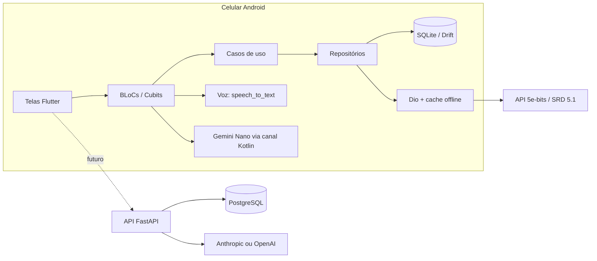

# CritSense — Guia de Estudo

Este guia resume como o CritSense funciona e por que cada decisão técnica foi tomada. Ele serve para estudar o código, não para usar o app. Para as tarefas e o histórico das fases, veja o [ROADMAP](ROADMAP.md).

---

## 1. Visão geral

O CritSense é um monorepo com duas aplicações e uma versão de estudo da API:

| Parte | Tecnologia | O que faz |
|---|---|---|
| [app/](../app/) | Flutter 3.44, Dart 3.12 | Ficha de D&D 5e, compêndio, rastreador de iniciativa, rolador de dados e comandos por voz. Funciona sem a API. |
| [api/](../api/) | Python 3.15, FastAPI, SDK da Anthropic | Autenticação JWT e o gerador de NPCs com IA. O app ainda não chama a API. |
| [api-java/](../api-java/) | Java 21, Spring Boot 4.1, Spring AI 2.0 | A mesma API em Java, mantida como estudo. Tem um contrato próprio (`api-java/openapi.yaml`). |
| [contracts/](../contracts/) | OpenAPI 3 | Contrato da API, conferido no CI. |



---

## 2. Arquitetura do app

### 2.1 Camadas

Cada feature em `app/lib/features/` tem três camadas:

| Camada | Conteúdo | Regra |
|---|---|---|
| `domain` | Entidades, regras do SRD, casos de uso e interfaces | Não importa Flutter, Drift nem Dio. |
| `data` | Repositórios, data sources e mapeamento | Implementa as interfaces do domínio. |
| `presentation` | BLoCs, Cubits, telas e widgets | Fala só com casos de uso e com o domínio. |

As features atuais são `character_sheet`, `compendium`, `dice_roller`, `initiative_tracker`, `voice_commands`, `home` e `auth`. O código compartilhado fica em `app/lib/core/` (banco, rede, arquivos, tema, canal nativo).

### 2.2 Fluxo de uma ação

Exemplo: o jogador aplica 8 de dano na ficha.

1. A tela envia `ApplyDamageEvent(id, 8)` para o `CharacterBloc`.
2. O BLoC chama `character.withDamage(8)`, uma função pura do domínio (`hit_point_rules.dart`).
3. A regra tira primeiro dos PV temporários e depois dos PV atuais. Ela também trata o dano massivo e as salvaguardas contra a morte.
4. O BLoC chama `withConcentrationChecked()`, que termina a concentração com 0 PV.
5. O BLoC salva o personagem novo e emite a lista atualizada.
6. A tela se redesenha com o estado novo.

> Estude: [character_bloc.dart](../app/lib/features/character_sheet/presentation/bloc/character_bloc.dart) (método `_updateCharacter`) e [hit_point_rules.dart](../app/lib/features/character_sheet/domain/rules/hit_point_rules.dart).

### 2.3 Regras do SRD como funções puras

As regras de D&D ficam em `domain/rules/` como extensões de `Character`. Cada método devolve um personagem novo, ou `null` quando nada muda.

| Arquivo | Regras |
|---|---|
| `hit_point_rules.dart` | Dano, cura, PV máximo, morte, descansos, condições |
| `spell_rules.dart` | Espaços de magia e Magia de Pacto |
| `class_resource_rules.dart` | Fúria, Ki, Surto de Ação e outros recursos com usos |
| `concentration_rules.dart` | CD do teste de concentração e fim da concentração |
| `level_rules.dart` | XP e subida de nível |
| `equipment_rules.dart` | CA com armadura e escudo, ataques das armas |
| `roll_rules.dart` | Vantagem e desvantagem sugeridas pelas condições |

Os dados fixos do SRD (classes, raças, tabelas de magia) ficam em `domain/srd/` como `enum`.

---

## 3. Decisões técnicas

Cada decisão tem o motivo e a alternativa que o projeto não escolheu.

### 3.1 App

| Decisão | Motivo | Alternativa descartada |
|---|---|---|
| **BLoC/Cubit** (`flutter_bloc`) | Estados imutáveis e transições fáceis de testar. Cubit para estados simples, BLoC para eventos variados. | Provider ou Riverpod: menos cerimônia, mas o projeto quis praticar BLoC. |
| **`get_it`** para injeção | Um só lugar registra tudo ([injection_container.dart](../app/lib/di/injection_container.dart)). Os testes trocam as peças com `sl.reset()`. | Injeção pelo construtor em toda a árvore de widgets. |
| **Drift (SQLite)** | Consultas tipadas, migrações versionadas e testes com banco em memória. | Hive ou Isar: sem SQL, mas com migrações mais fracas. |
| **Migrações incrementais** (`from < N`) | Um usuário com qualquer versão antiga chega à atual sem perder dados. O banco está na versão 15. | Recriar o banco a cada versão. |
| **Cópia do banco antes de migrar** | A versão do schema fica nos bytes 60 a 63 do arquivo SQLite. O app lê esses bytes sem abrir o banco. | Confiar só nos testes de migração. |
| **Listas em colunas JSON** | Proficiências, condições e idiomas são listas simples, sem consultas próprias. | Uma tabela para cada lista. |
| **Regras no domínio, não na IA** | PV, dados e CD precisam de resultado exato e testável. | Pedir os cálculos ao modelo de linguagem. |
| **Cache offline no Dio** | Um interceptor guarda cada resposta GET do compêndio. Sem rede, o app usa a cópia. | Baixar o SRD inteiro na instalação. |
| **`SharedPreferences`** para o tema, o histórico de rolagens e o combate | Dados pequenos, sem relações. | Tabelas novas no Drift. |
| **Interfaces na frente do hardware** (`SpeechInput`, `OnDeviceAi`, `BackupFileGateway`) | Os testes usam versões falsas, sem microfone, sem Android e sem seletor de arquivos. | Chamar os plugins direto nos widgets. |
| **Backup em JSON com `format` e `version`** | Um app novo lê arquivos antigos e recusa arquivos de outro app com uma mensagem clara. A importação gera ids novos. | Exportar o arquivo `.sqlite`. |

### 3.2 Comandos por voz e IA no aparelho

| Decisão | Motivo |
|---|---|
| **Regras fixas antes do modelo** ([rule_based_parser.dart](../app/lib/features/voice_commands/domain/services/rule_based_parser.dart)) | São instantâneas, funcionam em qualquer celular e têm testes com frases de exemplo. |
| **Gemini Nano só para frases livres** ([command_interpreter.dart](../app/lib/features/voice_commands/domain/services/command_interpreter.dart)) | O modelo só existe em alguns aparelhos e a resposta muda a cada chamada. |
| **Modelo devolve JSON validado** ([llm_command_parser.dart](../app/lib/features/voice_commands/domain/services/llm_command_parser.dart)) | O app confere a ação, os limites dos números e a notação dos dados. Uma resposta fora do formato vira "não entendi". |
| **Confirmação antes de aplicar** | Um erro de transcrição não muda a ficha sozinho. |
| **A folha de voz não aplica nada** | Ela devolve um `VoiceCommand`. A tela que abriu decide o evento: a ficha e o rastreador tratam o mesmo comando de formas diferentes. |
| **Canal Kotlin próprio** ([OnDeviceAiChannel.kt](../app/android/app/src/main/kotlin/com/marivaldojunior/critsense/crit_sense/OnDeviceAiChannel.kt)) | Não existe plugin Flutter oficial para o ML Kit GenAI. O projeto já tinha o padrão de canal no sensor de shake. |
| **Resumo de sessão no aparelho** | As notas do jogador não saem do celular. |

### 3.3 API

| Decisão | Motivo |
|---|---|
| **Troca de Java para Python** | A API Python faz o mesmo com menos código e serve para estudar FastAPI. A API Java continua em `api-java/` para comparar as duas. |
| **FastAPI + Pydantic 2** | Os modelos Pydantic validam o corpo, geram o contrato OpenAPI e geram o JSON Schema que a IA recebe. |
| **`create_app()` e `Depends`** | A fábrica recebe a configuração e o modelo de chat. Os testes trocam essas peças sem mocks globais. |
| **Interface `ChatModel` com um adaptador por provedor** (`AI_PROVIDER`) | Troca Anthropic por OpenAI sem mudar o resto do código. A chave fica só no backend. |
| **Saída da IA em JSON validado** (Pydantic) | Uma resposta inválida ganha uma nova tentativa com a lista de erros. Depois disso, a API devolve um erro, nunca um JSON quebrado. |
| **Prompts versionados** (`critsense/prompts/npc-generator/v1/`) | Uma mudança no prompt vira uma versão nova, com histórico no Git. |
| **JWT HS256 sem sessão** (PyJWT) e **Argon2** (`pwdlib`) | A API não guarda estado do login. O hash da senha roda numa thread para não travar o event loop. |
| **Rate limit por usuário** (token bucket em memória) | Chamadas de IA custam dinheiro. A API devolve `429` com `Retry-After`. |
| **Erros RFC 9457** (`application/problem+json`) | Um formato único de erro, com um `code` estável para o cliente. A API devolve `400`, e não o `422` padrão do FastAPI. |
| **SQLAlchemy 2 async + Alembic** | O schema do PostgreSQL muda por migrações versionadas, como no app. Um teste confere se os modelos e as migrações estão iguais (`alembic check`). |
| **Monstros do SRD numa migração** (`migrations/data/`) | O cálculo de dificuldade não depende de uma API externa. Os dados ficam versionados e são conferidos contra a tabela de XP por CR. |
| **Dificuldade como função pura** (`encounters/rules.py`) | A regra do SRD 5.2.1 tem testes com os exemplos do próprio SRD, sem banco e sem IA. A IA só vai criar a ambientação (T2.4). |
| **uv + `uv.lock`** | As versões das dependências ficam fixas, iguais no computador, no CI e no Docker. |
| **Ruff + mypy `strict`** | Um só linter e formatador, e tipos conferidos em todo o código. |
| **Testcontainers + `FakeChatModel`** | Os testes usam um PostgreSQL real e nunca chamam o provedor de IA. |
| **Contrato OpenAPI no CI** | O CI falha se o código e o `contracts/openapi.yaml` ficam diferentes. |

### 3.4 Repositório e CI

| Decisão | Motivo |
|---|---|
| **Monorepo** | O app, a API e o contrato mudam juntos num só commit. |
| **Workflows com filtro de `paths`** | Uma mudança no app não roda o CI da API, e o contrário também vale. |
| **Ruff**, **Spotless** (na API Java) e **`flutter analyze`** | O estilo do código não depende de quem escreve. |

---

## 4. Testes

O app tem mais de 330 testes em `app/test/`. A API Python tem 106 testes em `api/tests/`. A API Java tem 53 testes em `api-java/src/test/`.

| Tipo | Exemplo | O que aprender |
|---|---|---|
| Regra pura | `hit_point_rules_test.dart` | Testar regras sem Flutter. |
| BLoC | `character_bloc_resources_test.dart` | Esperar estados com `bloc.stream.firstWhere`. |
| Widget | `status_combat_tab_test.dart` | `tester.runAsync`, `scrollUntilVisible` e `ensureVisible`. |
| Migração | `app_database_migration_test.dart` | Criar um banco antigo à mão e comparar com um banco novo. |
| Canal nativo | `on_device_ai_test.dart` | `setMockMethodCallHandler` no lugar do Android. |
| Voz | `rule_based_parser_test.dart` | Tabelas de frases de exemplo. |
| API | `test_npc.py` | `TestClient`, `dependency_overrides` e um modelo de chat falso. |
| Integração (API) | `test_integration.py` | Testcontainers com PostgreSQL e as migrações do Alembic. |

Para rodar:

```bash
cd app && flutter test
```

```bash
cd api && uv run pytest
```

```bash
cd api-java && ./mvnw verify
```

---

## 5. Roteiro de estudo

Leia o código nesta ordem. Cada passo usa o que o passo anterior mostrou.

1. Leia a entidade [character.dart](../app/lib/features/character_sheet/domain/entities/character.dart) e os valores derivados.
2. Leia uma regra pura, como [concentration_rules.dart](../app/lib/features/character_sheet/domain/rules/concentration_rules.dart), e o teste dela.
3. Siga um evento no [character_bloc.dart](../app/lib/features/character_sheet/presentation/bloc/character_bloc.dart) até o repositório.
4. Leia o [app_database.dart](../app/lib/core/database/app_database.dart) e o teste de migração.
5. Leia o [offline_cache_interceptor.dart](../app/lib/core/network/offline_cache_interceptor.dart).
6. Siga um comando de voz: `rule_based_parser.dart` → `voice_command_cubit.dart` → `apply_voice_command.dart`.
7. Compare o canal Dart (`method_channel_on_device_ai.dart`) com o canal Kotlin (`OnDeviceAiChannel.kt`).
8. Na API, siga `npc/router.py` → `npc/service.py` → `ai/structured.py` → `ai/gateway.py` → `ai/chat.py`.
9. Compare com o mesmo caminho na API Java: `NpcController` → `NpcService` → `StructuredAiService` → `AiGateway`.

---

## 6. Exercícios

1. Adicione o comando de voz "inspiração" para ligar e desligar o marcador de inspiração. Escreva o teste do parser primeiro.
2. Adicione uma coluna nova ao personagem. Faça a migração para a versão 16 e confira o teste de migração.
3. Escreva uma regra pura para o talento Robusto (+2 PV por nível) e o teste dela.
4. Gere o cliente Dart do `contracts/openapi.yaml` (tarefa T1.15 do roadmap).
5. Troque o prompt do gerador de NPCs para uma versão `v2` e compare as respostas.

---

## 7. Glossário

| Termo | Significado |
|---|---|
| **SRD 5.1** | Regras abertas de D&D 5e (licença CC-BY-4.0). |
| **BLoC** | Business Logic Component: recebe eventos e emite estados. |
| **Cubit** | BLoC simples, com métodos no lugar de eventos. |
| **Drift** | Biblioteca de SQLite para Dart, com código gerado. |
| **MethodChannel** | Canal de chamadas entre o Dart e o código nativo (Kotlin). |
| **Gemini Nano** | Modelo de linguagem do Google que roda no celular, pelo AICore do Android. |
| **ML Kit GenAI** | API do Google para usar o Gemini Nano no Android (em beta). |
| **FastAPI** | Framework web do Python, com validação pelo Pydantic e contrato OpenAPI gerado. |
| **Pydantic** | Biblioteca do Python que valida dados com base nas anotações de tipo. |
| **Alembic** | Ferramenta de migrações do SQLAlchemy. |
| **uv** | Gerenciador de pacotes e de ambientes virtuais do Python. |
| **Spring AI** | Biblioteca do Spring para chamar modelos de linguagem (na API Java). |
| **ProblemDetail** | Formato de erro HTTP da RFC 9457. |
| **Testcontainers** | Biblioteca que sobe containers Docker nos testes. |
